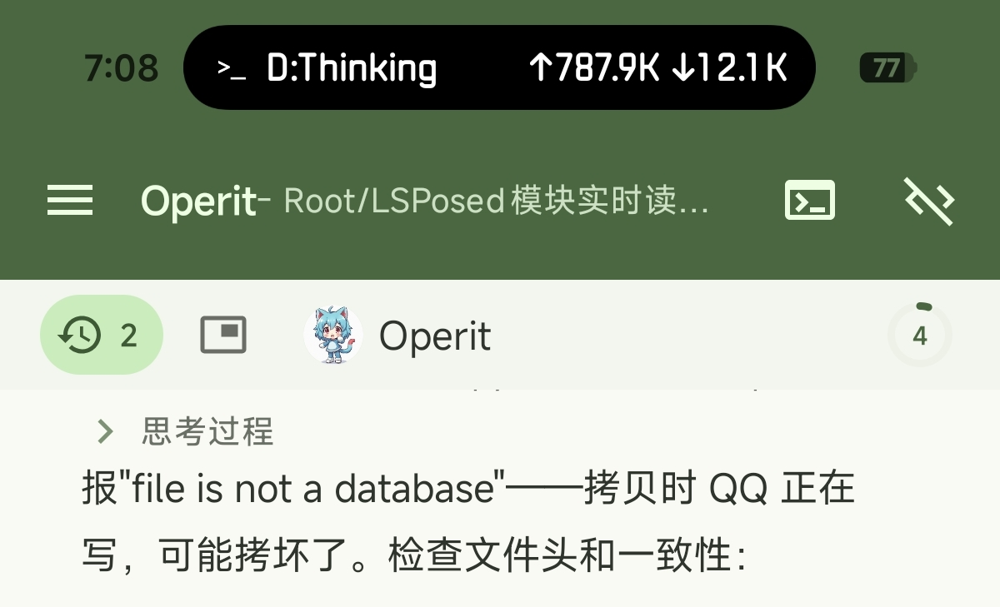
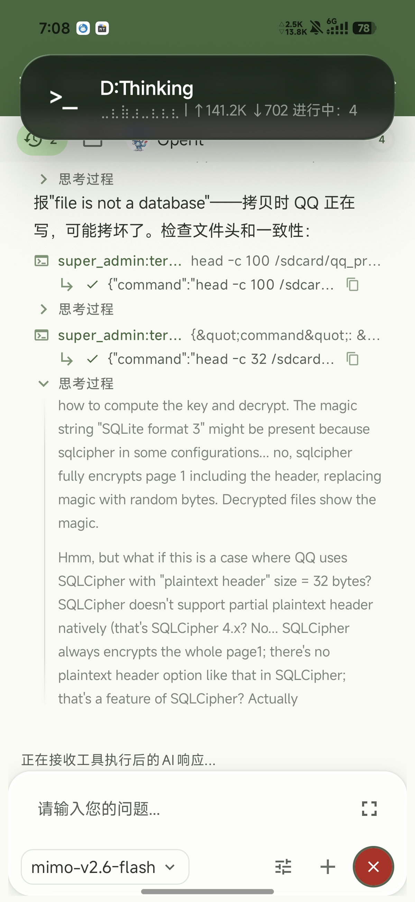
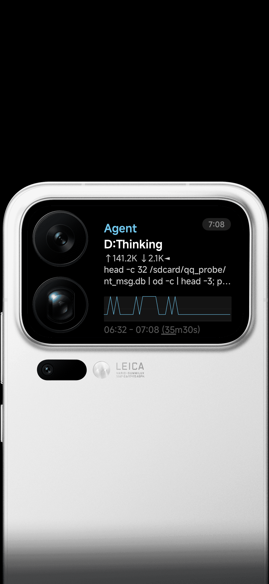
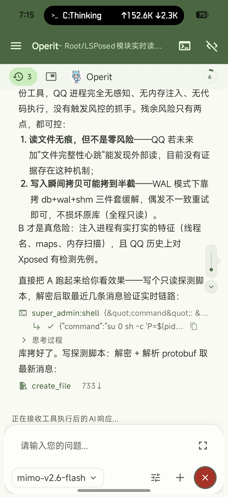

# ⚠️ 关于这个项目

**这是一个 vibecoding 项目**——由非专业开发者借助 AI 辅助编程完成。**目前存在稳定性问题**（显示偶发闪烁、个别场景状态不同步等），请勿用于任何重要或生产场景。

> 我的编程水平并不好，vibecoding 经验也不足，请各位极客玩家多多包容。

---

# RearProgress — Operit 工具调用 → 小米背屏进度卡

把 Operit 的每次工具调用实时投到小米 17 Pro Max 的背屏上（HyperOS 4.0 / Android 17）。

## 效果

```
┌──────────────────────────────────┐
│ 任务进行中                    ●   │  18px semibold 白   ← 状态 / AI 进度
│ super_admin:shell                 │  20px semibold 纯白 ← 工具名（主体）
│ rm -f /data/local/tmp/agent_...   │  14px regular #99   ← 参数（弱化）
│ ▓▓▓▓▓▓▓▓▓▓▓▓▓░░░░  92%            │  8px 进度条
└──────────────────────────────────┘
```

状态机：`已就绪` →（有工具调用）`任务进行中` →（收到回复完成）`已完成`
AI 可主动写 `/data/local/tmp/agent_progress.txt` 上传进度，优先显示在主标题，5 分钟过期。

## 界面预览

| 正面胶囊 | 展开态（跳点） |
|---|---|
|  |  |
| **背屏卡片** | **App 界面** |
|  |  |

## 完整链路

```
Operit 进程                       副屏中心进程                背屏
─────────────────────────────────────────────────────────────────────
AIToolHandler.executeTool  ─┐
  （Hook：工具名+参数）      │
notifyReplyCompleted       ─┤
  （Hook：标记已完成）       │
                            ▼
                  NotificationManager.notify（固定 ID 0x4147454E）
                  Style = ProgressStyle + FLAG_ONGOING_EVENT
                  title / subText / text / progress
                            │
                            ▼
                  SmartAssistantNotificationListenerService
                    a() 无 miui.focus.param → 放行
                    b() flags & 0x2 → Hook 强制 isPromotedOngoing=true
                    m2.b.b() 类名比对 Style → business=live_update_progress
                    把 extras 里所有 lu_* 打包进 miui.liveupdate.param
                            │
                            ▼
                  m2.d.i(business, pkg) → 模板路径
                    ★ Hook 重定向到 /data/local/tmp/rp_tpl/<name>
                            │
                            ▼
                  MamlWidget 渲染 MAML 模板 → 背屏卡片
```

## 三个关键 Hook（副屏中心侧）

| 目标 | 作用 | 必须性 |
|---|---|---|
| `k2.I.i()` | 实时更新总开关，恒返回 true | 开关关了直接丢弃 |
| `SmartAssistantNLS.b()` | 强制 `isPromotedOngoing()` = true | 反射拿不到系统内部标志 |
| `m2.d.i(String,String)` | 模板路径重定向到 `/data/local/tmp/rp_tpl/` | **改模板的核心** |

## 为什么改模板要 Hook

`/data/system/theme_magic/users/<uid>/subscreencenter/smart_assistant/<name>`
里的模板每次副屏中心启动都会被从 APK 重新释放（实测 md5 回滚、`Clear cache`）。

所以模板必须放在 `/data/local/tmp/rp_tpl/`，由 `m2.d.i()` 的 Hook 重定向过去。

已试过但**不是**实际调用点的（不要重复踩）：
`ZipResourceLoader` 构造器、`j2.a.f()`、`m2.a.a()` —— 都没被调用。

注意 `m2/a.c` 静态表里的值是字面量 `.../users/$user_id/...`，需要展开。

## 目录

```
app/src/main/java/com/operit/rearprogress/
  MainHook.java      副屏中心侧 Hook（含模板路径重定向）+ 轮询
  OperitHook.java    Operit 侧 Hook（工具调用 / 回复完成 / 进度文件）
  AgentProgress.java 状态机 + 三段内容组装
  FocusNotify.java   通知构造（ProgressStyle + 固定 ID + 进度条 extras）
  LogX.java          日志（logcat tag=RearProgress）
tpl/
  live_update_progress/manifest.xml   自定义 MAML 模板（源码）
  lup_ui.zip                          打包产物
  pack.py                             打包脚本
  deploy.sh                           部署到 /data/local/tmp/rp_tpl
  learn/                              学习用模板样本（gitignore）
```

## 构建与部署

```bash
./gradlew :app:assembleDebug --offline
cp app/build/outputs/apk/debug/app-debug.apk /data/local/tmp/RearProgress.apk
pm install -r /data/local/tmp/RearProgress.apk
am force-stop com.xiaomi.subscreencenter        # 副屏中心重载 Hook
sh tpl/deploy.sh                                # 部署模板（改了模板才需要）
# Operit 进程需手动重启才会加载新的 OperitHook
```

## 环境

- 小米 17 Pro Max，HyperOS OS4.0.0.39.XPBCNXM，Android 17，背屏 displayId=1
- KernelSU + LSPosed 2.2.1 (API 102)，模块用 libxposed API 102
- 作用域：`com.xiaomi.subscreencenter` + `com.ai.assistance.operit`
- 副屏中心必须在通知监听白名单：
  `cmd notification allow_listener com.xiaomi.subscreencenter/com.xiaomi.subscreencenter.smartassistant.SmartAssistantNotificationListenerService`

## 已知风险

- 依赖混淆类名（`k2.I`、`m2.b`、`m2.d.i`、`AIToolHandler`），系统或应用升级可能静默失效
- 通知**不能带** `miui.focus.param`，否则 `a()` 直接 return（焦点通知是排除标志，不是背屏通道）
- Style 必须是 `ProgressStyle` / `BigTextStyle` / `CallStyle` 之一，其余被 `m2.b.b()` 丢弃

## 构建环境（ARM64）

Gradle 官方 AAPT2 在 ARM64 Linux 不可用，仓库内置了替换版：

```bash
chmod +x ./setup_android_env.sh
./setup_android_env.sh
```

- 来源：https://github.com/ReVanced/aapt2/releases/tag/v1.0.0
- SHA-256: `e5b5ff7f0d4f6ecd7fa5d05d77fed3f09f6f1bf80f078b8aada82bc578848561`

